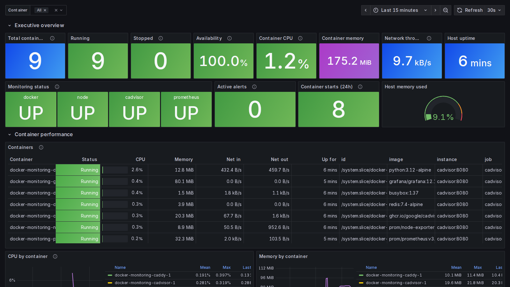
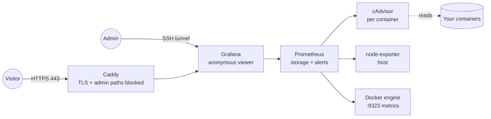

# Docker Monitoring Dashboard

[](https://github.com/fadym555/docker-monitoring-dashboard/actions/workflows/ci.yml)

A ready-to-deploy monitoring stack for Docker hosts. It gives you a public, read-only Grafana dashboard over HTTPS showing which containers are running, what they use (CPU, memory, network), how healthy the host is, and how things have changed over time.

Everything runs with one `docker compose up`. Every push is tested end to end in CI on a real Docker host: the stack starts, every scrape target must be up, every dashboard query must return data, and the public endpoint must block logins and edits.



## What you get

| Need | How it is covered |
|---|---|
| Container status (running / stopped / total) | Docker engine metrics (`engine_daemon_container_states_containers`) |
| Per-container CPU, memory, network | cAdvisor |
| Host CPU, memory, disk, load, uptime | node-exporter |
| History and trends | Prometheus, 15 days by default, time picker 15m → 7d |
| Health at a glance | Green / orange / red thresholds on every KPI, plus alert rules |
| Public access | Caddy with automatic HTTPS; visitors are anonymous **viewers** |
| Admin access | Grafana and Prometheus bound to `127.0.0.1`, reached through an SSH tunnel |

### Dashboard sections

1. **Executive overview**: total / running / stopped containers, availability %, container CPU and memory, network throughput, host uptime, monitoring status per target, active alerts, container restarts in 24h, host memory gauge.
2. **Container performance**: a live table (status, CPU, memory, network in/out, uptime) plus CPU, memory and network charts per container. Filter with the **Container** dropdown.
3. **Host**: CPU, memory, disk, network and load average.

## Architecture



## Deploy on a server (AWS EC2 or any Ubuntu VM)

**Recommended size:** `t3.small` (2 vCPU, 2 GB) with a 20 GB gp3 disk. That is roughly **$17–20/month** on demand in `us-east-1`. A `t3.micro` works for a handful of containers.

1. Launch Ubuntu 24.04. In the security group allow inbound **22, 80, 443** only.
2. Optional: point a DNS `A` record (for example `monitor.example.com`) at the instance's public IP. Without one, the script uses `<ip>.sslip.io`, which still gets a real certificate.
3. On the server:

   ```bash
   git clone https://github.com/fadym555/docker-monitoring-dashboard.git
   cd docker-monitoring-dashboard
   sudo bash scripts/install-ubuntu.sh monitor.example.com   # or leave the domain out
   ```

   The script installs Docker, turns on engine metrics, enables the firewall (SSH/HTTP/HTTPS only), creates `.env` with a random admin password, and starts the stack.

4. Open `https://<your-domain>`. The dashboard loads with no login.

### Admin access

```bash
ssh -L 3000:127.0.0.1:3000 -L 9090:127.0.0.1:9090 ubuntu@<server>
```

Then open `http://localhost:3000` (Grafana admin, password in `.env`) and `http://localhost:9090` (Prometheus).

### Monitor your own containers

Any container on the host shows up automatically. Run your workloads as usual and they appear in the table and charts within about 15 seconds. To hide the sample workloads, set `COMPOSE_PROFILES=` (empty) in `.env` and run `docker compose up -d --remove-orphans`.

## Run locally

Needs Docker Engine on Linux (cAdvisor reads the host's cgroups).

```bash
sudo jq -s '.[0] * .[1]' /etc/docker/daemon.json docker/daemon.json   # merge, or copy docker/daemon.json if you have none
sudo systemctl restart docker
cp .env.example .env            # set GRAFANA_ADMIN_PASSWORD
make up                         # docker compose up -d --wait
make test                       # end-to-end checks
```

Open `https://localhost` (self-signed certificate locally).

## Operating it

| Task | Command |
|---|---|
| Status | `make ps` |
| Logs | `make logs` |
| Stop (keeps history) | `make down` |
| Start again | `make up` |
| Update images | edit the pinned tags in `compose.yaml`, then `make up` |
| Remove everything including stored metrics | `make clean` |
| On AWS, stop paying | stop the instance (you still pay for the disk, ~$1.60/month) or terminate it |

## Security

- Only ports 80 and 443 are public. Grafana and Prometheus listen on `127.0.0.1`; cAdvisor and node-exporter are not published at all.
- Public visitors get the Grafana **Viewer** role: no editing, no sign-up. Caddy returns 404 for `/login`, `/admin` and admin APIs.
- HTTPS with HSTS, plus `nosniff`, `SAMEORIGIN` framing and a strict referrer policy.
- Docker engine metrics (`:9323`) are blocked from the internet by the firewall and the security group.
- Every image is pinned to a version. CPU and memory limits and log rotation are set on every service.
- CI checks all of this on every push.

## Alerts

`prometheus/alerts.yml` defines: scrape target down, stopped containers, container CPU > 80%, container memory > 90% of its limit, host CPU > 85%, disk > 85% full. They show in the **Active alerts** tile. To get notified by email or Slack, add a contact point in Grafana (admin) or add Alertmanager.

## Repository layout

```
compose.yaml                       the whole stack
caddy/Caddyfile                    HTTPS reverse proxy
prometheus/prometheus.yml          scrape targets
prometheus/alerts.yml              alert rules
grafana/provisioning/              datasource + dashboard provider
grafana/dashboards/                the dashboard (JSON)
docker/daemon.json                 enables Docker engine metrics
scripts/install-ubuntu.sh          one-command server setup
tests/smoke.sh                     end-to-end checks
.github/workflows/ci.yml           lint + e2e on a real Docker host
```

## Use as a template

This repository is a GitHub template. Click **Use this template**, change `DOMAIN` and the dashboard title, and add scrape targets in `prometheus/prometheus.yml` for anything else you want to watch.
